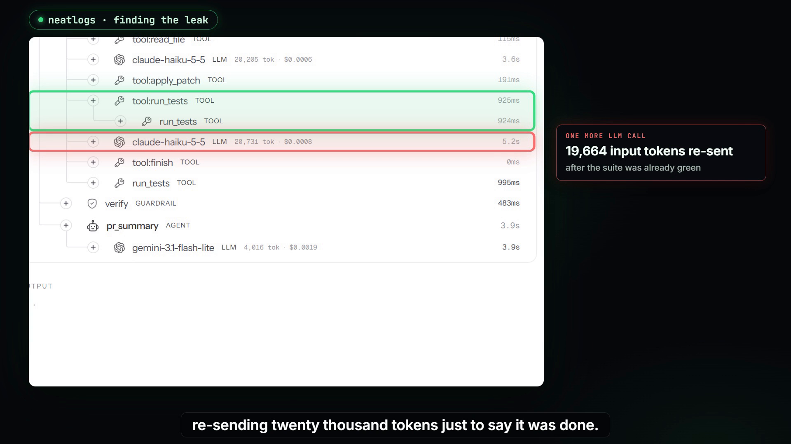

# Greenlight at neatHack: evidence for judges

Greenlight is an agent that completes one substantial task end to end: **upgrade a Python dependency across a
major version (pydantic 1→2, numpy 1→2, SQLAlchemy 1.4→2.0) and fix the code until the project's own test suite
passes again**, then prove the pass is real and open a PR. Every claim below links to something you can check.

**Demo video (2:47, covers neatlogs, Entire and cfo.ai):** [`docs/neathack/greenlight-neathack-demo.mp4`](greenlight-neathack-demo.mp4). The X post carries a 2:18 cut because X limits video length.

| What judges asked for | Where to check it |
|---|---|
| **Agent does a substantial task end to end** | The pipeline: `greenlight/agent.py` (baseline → bump → research → plan → migrate → repair → editor tool loop → verify → PR). Results on 12 real repos: [`evals/results/eval-official`](../../evals/results/eval-official), live replays at https://manuvamp.github.io/greenlight/ |
| **neatlogs: traces** | Integration: [`greenlight/tracing.py`](../../greenlight/tracing.py) (one trace per run: WORKFLOW → CHAIN stages → AGENT plan/migrate → LLM calls → TOOL calls → GUARDRAIL verify). Trace IDs: before `e213e27738b12a3ea704c312acf28da7`, after `fa5bf9114111431bba27f14f411bb84b`, bulk-mode run `2eb8c43c6f9c277fb69e076340872c1d`. Screenshots in [`docs/neathack/img`](img) (neatlogs traces are private to the team, so the screenshots are the public record). |
| **Agent improved (before vs after, with numbers)** | Issue found in the traces, fixed in commit `2c0d677`, measured on the same repo (blocklib, pydantic 1→2). Table below. Raw event logs: [`evals/results/neathack-before-nobulk`](../../evals/results/neathack-before-nobulk), [`evals/results/neathack-after-nobulk`](../../evals/results/neathack-after-nobulk). Recompute: `python scripts/compare_runs.py <before>.jsonl <after>.jsonl`. |
| **Failure recovery** | Every traced run: after the bump, `run_tests` is an ERROR span (0 of the 40 baseline tests pass: the suite fails to even collect under pydantic 2); the agent researches, plans and migrates until it is green again. In both before/after runs the editor also repeated a `read_file` call twice; the repeat guard refused both (`REPEATED`, red in the trace) and the editor moved on to patching. In the bulk-mode run (`2eb8c43c…`), the one-pass migration left 39/40; a repair round and the editor's patch to the last failing test brought it to 40/40. Failed spans are marked by `_error()` in `tracing.py`. |
| **Entire: Checkpoints** | Enabled in the repo (`.entire/settings.json`, hooks in `.claude/settings.json`). Checkpoint `01M4R8E64AQPMSR6BFWPV1H74J` links fix commit `2c0d677` to the Claude Code session that wrote it (captured by Entire's hooks). Checkpoint `01M4R8BSCGQXAM5K6A6T1GRD1B` attaches the session that built Greenlight (Oct 10–12; secrets redacted by Entire). Both are pushed as `refs/entire/checkpoints/*` on GitHub: `git fetch origin 'refs/entire/*:refs/entire/*' && entire checkpoint list`. |
| **cfo.ai: business plan** | Ari (cfo.ai) built a 24-month model and written plan from our measured unit costs: pricing, costs, revenue, runway, break-even (month 11), downside and upside scenarios, risks. [`docs/neathack/business-plan.md`](business-plan.md), screenshots [`img/cfo-business-plan.png`](img/cfo-business-plan.png), [`img/cfo-scenarios.png`](img/cfo-scenarios.png). Inputs: [`business-inputs.md`](business-inputs.md). |
| **Code written during the event** | `git log --reverse`: first commit `b8b9106` on **Oct 10 17:07 IST** (kickoff was 12:30 IST); every commit is dated Oct 10–12. |
| **Building in public** | #neatHack progress post with the neatlogs trace: https://x.com/TheHomelessEnt/status/2109656444811579843 · demo video quote-post: https://x.com/TheHomelessEnt/status/2109689017059176547 |

## The improvement, in numbers

**What the traces showed.** At the end of the editor loop, `run_tests` returned `ALL PASS`, and the editor still got
another turn: one more LLM call that re-sent the whole conversation (19,664 input tokens) only to call `finish`,
followed by a second full test run on unchanged code.

 Scanning older event logs: all 14 earlier runs that went green
inside the editor loop (9 on stand-in models, 5 older runs that predate the backend field) did this, making 1–7
editor calls after the first `ALL PASS`.

**The fix** (`2c0d677`, `greenlight/agent.py`): remember the code state at which a full test run was green; stop the
editor right there and skip the duplicate re-run. The green verdict still comes from a real full run.

**Before/after, same repo and settings** (blocklib, pydantic 1.10 → 2.14, editor loop only, stand-in models,
cost at Nemotron prices):

| metric | before (`4ef69c7`) | after (`2c0d677`) | change |
|---|---|---|---|
| result | green 40/40 | green 40/40 | |
| LLM calls | 14 | 11 | −21% |
| editor calls | 12 | 9 | −25% |
| input tokens | 223,708 | 169,370 | −24% |
| full test runs | 5 | 4 | −20% |
| cost | $0.0944 | $0.0780 | −17% |
| time from `ALL PASS` to end of fix stage | 6.2 s | 0 s | |

Honest caveat: model runs vary. The part the fix removes for sure is the post-green tail (one editor turn plus one
test run per green run). The rest of the gap in this pair is run-to-run variance in how many turns the editor needed
before going green.
