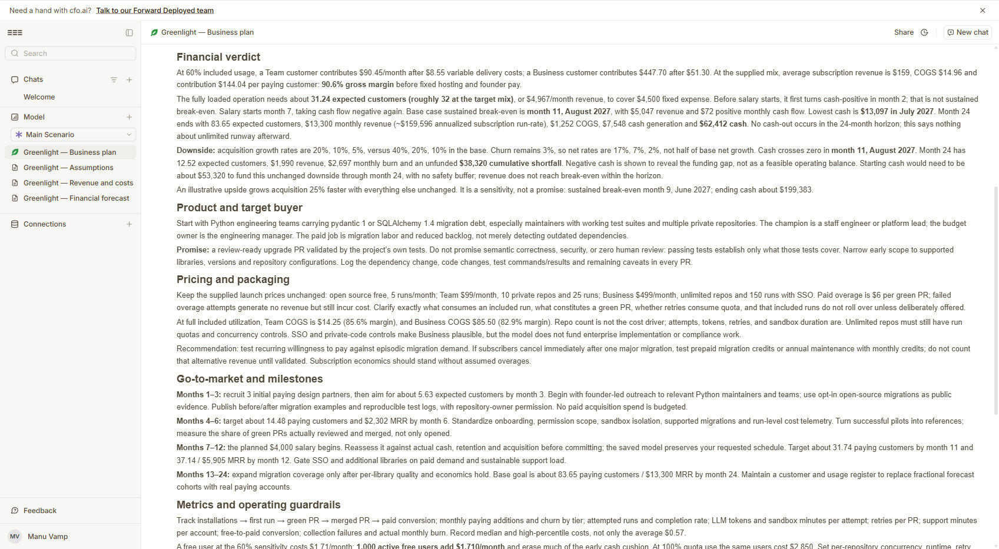
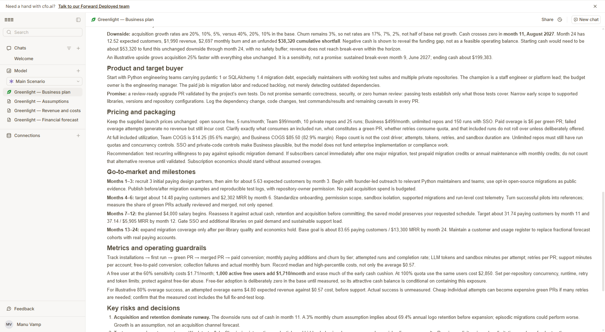

# Greenlight: business plan

Planned with **cfo.ai**: the measured inputs in [`business-inputs.md`](business-inputs.md) went to Ari, cfo.ai's AI CFO, which built a 24-month model (assumptions, revenue and costs, forecast, scenarios) and a written business plan. Ari's numbers are in the next section; the hand-built projection further down was the cross-check, and both agree (break-even month 11-12, cash never below about $12-13k).

## cfo.ai (Ari): 24-month model and plan

Forecast window: October 2026 to September 2028, USD, no outside funding. Ari reported all three tasks complete.

### Headline numbers (base case)

- Break-even: first cash-positive month before salary is month 2. Sustained break-even including the $4,000/month salary (from month 7) is month 11, August 2027, at $5,047 revenue and $72 positive monthly cash flow.
- Runway: no cash-out within the 24-month horizon. Ari notes this does not mean unlimited runway after month 24.
- Cash low point: $13,097 in July 2027 (salary step pushes cash flow negative again).
- Month-6 MRR: $2,302 (about 14.48 paying customers). From the business plan milestones.
- Month-12 MRR: $5,905 (about 37.14 paying customers; about 31.74 by month 11). From the business plan milestones. The forecast grid's own values did not render in the browser tab.
- Month-24 MRR (monthly revenue): $13,300 (about $159,596 annualized). Month-24 paying customers: 83.65 expected.
- Month-24 COGS: $1,252. Month-24 net cash flow: +$7,548. Month-24 cash: $62,412.
- Gross margin: 90.6% (blended, before fixed hosting and salary).
  - Team: $99 revenue, $8.55 variable delivery cost, $90.45 contribution per customer per month.
  - Business: $499 revenue, $51.30 variable cost, $447.70 contribution.
  - Blended: $159 revenue, $14.96 COGS, $144.04 contribution per paying customer.
- Break-even customer count: about 32 paying customers at the 85/15 mix to cover $4,500/month fixed cost ($500 + $4,000 salary).

### Downside: half growth

- Acquisition growth 20%, 10%, 5% (base 40%, 20%, 10%). Churn stays 3%.
- Cash crosses zero in month 11, August 2027.
- Month 24: 12.52 expected customers, $1,990 revenue, net cash flow -$2,697, unfunded cumulative shortfall $38,320.
- Starting cash of about $53,320 would be needed to fund this downside through month 24 with no buffer. Revenue does not reach break-even within the horizon.

### Upside (illustrative)

- Acquisition 25% faster, everything else unchanged. Sustained break-even month 9 (June 2027), ending cash about $199,383. Sensitivity only, not a forecast.

### Key assumptions Ari flagged

- Included runs used at 60%. Overage revenue assumed zero.
- Free tier: no adoption forecast was supplied, so free users are set to zero. This is an unbudgeted exposure. At 60% usage, 1,000 active free users cost $1,710/month.
- Failed runs still cost delivery money. Overage success rate (80%) is an unmeasured assumption.
- Payment fees, payroll burden, taxes, marketing, legal, enterprise implementation and extra staff are not included.

### Risks (from Ari)

1. Subscriptions versus episodic demand: a team may pay for one migration and cancel. Validate recurring retention before relying on 3% monthly churn.
2. Free-tier costs are not budgeted yet.
3. Passing tests is not proof of correctness. Weak coverage, flaky CI and hidden behavior changes still need human review.
4. The $0.57 average may hide expensive jobs. Measure the full repair-and-test loop, including retries, large repos and long test runs.
5. Lean plan: payment fees, payroll burden, taxes, marketing, legal and staffing are excluded.

Ari's recommendation: run a 90-day paid pilot to measure retention, merged-PR quality and full-loop cost.

## Hand-built cross-check

### The business in one paragraph
Greenlight Cloud is a GitHub App that turns red "bump to the next major version" PRs into green ones: it migrates the
code, proves the project's own tests pass, and opens a PR that cites the migration guide. Teams pay a flat monthly fee
and only pay overage for upgrades that end green. Open-source repos get a free tier, which is the acquisition funnel.

### Pricing
| Plan | Price | Included |
|---|---|---|
| Open source | $0 | public repos, 5 runs / month |
| Team | $99 / month | 10 private repos, 25 runs / month |
| Business | $499 / month | unlimited repos, 150 runs / month, SSO, audit log |
| Overage | $6 per green PR | failed runs are free |

Blended revenue per paying team (85% Team, 15% Business): **$159 / month**.

### Costs
**Per upgrade run: ≈ $0.57.** LLM $0.50 (Nemotron on Nebius Token Factory: $0.04 small repo, $0.45–0.75 real repo,
measured), sandbox compute $0.02, web research $0.05 (rule sheets are cached per library and version).
Assuming teams use 60% of their included runs, COGS is ≈ $15 per paying team per month → **≈ 90% gross margin**.

**Fixed:** $500 / month (hosting, observability, CI, tools), plus a $4,000 / month founder salary from month 7.

### Revenue and runway (starting cash $15,000, no outside funding)
Growth: 3 paying teams in month 1, +40% / month to month 6, +20% to month 12, +10% after; 3% monthly churn.

| month | paying teams | MRR | COGS | fixed costs | net | cash |
|---|---|---|---|---|---|---|
| 1 | 3 | $477 | $45 | $500 | −$68 | $14,932 |
| 3 | 6 | $954 | $90 | $500 | $364 | $15,372 |
| 6 | 14 | $2,226 | $209 | $500 | $1,517 | $18,482 |
| 7 | 16 | $2,544 | $239 | $4,500 | −$2,195 | $16,286 |
| 9 | 22 | $3,498 | $329 | $4,500 | −$1,331 | $13,192 |
| 11 | 30 | $4,770 | $449 | $4,500 | −$179 | $12,114 |
| 12 | 34 | $5,406 | $509 | $4,500 | $397 | $12,511 |
| 18 | 51 | $8,109 | $763 | $4,500 | $2,846 | $23,249 |
| 24 | 75 | $11,925 | $1,122 | $4,500 | $6,303 | $51,703 |

- **Runway:** cash never drops below ~$12,100 (month 11), so the plan is fully funded. Even at zero revenue the fixed
  costs alone give 30 months of runway before the salary starts, and ~3 months after.
- **Break-even with a founder salary:** month 12 (34 paying teams).
- **Biggest risk:** the green rate on real repos (6/12 green on Nemotron today, 11/12 with stronger stand-in models).
  Every point of green rate is revenue, because customers only pay overage for green PRs. Tracing every run in neatlogs
  and fixing what the traces show is how that rate goes up; see [`EVIDENCE.md`](EVIDENCE.md).
- **What would change the plan:** LLM cost per run is the main COGS lever. The neatHack fix already cut input tokens
  ~24% on the measured pair.
